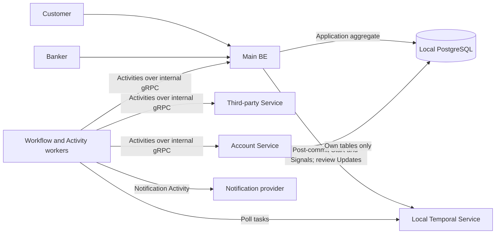

# Onboarding architecture

## Scope and current implementation

PR 09 corrects the PR 08 design to direct Main BE-to-Temporal SDK calls.
Protobuf files remain authoritative. Future contracts and migrations need approval.

StartApplication persists pending terms and then ensures startup. AcceptTerms
commits acceptance. SubmitIdentity commits identity and pending verification
atomically, without calling Temporal. Until PR 11 introduces identity signaling,
pending verification means ready for processing, not that a verification task has
started. The worker still executes only Await(false). Signals, Updates, business
Activities, automatic delivery recovery, and expiry are absent. ReviewApplication,
GetApplication, and UpdateApplicationStatus remain Unimplemented. Account is a
placeholder; VerifyIdentity uses immutable synthetic fixtures.

## Target ownership

| Component | Responsibility |
|---|---|
| Main BE | Application data, business validation, domain transitions, transactions, review audit, customer APIs, direct post-commit Temporal calls |
| Temporal workflow | Deterministic sequencing, durable waits/timers, Signal consumption, review arbitration, Activity scheduling |
| Activities | External I/O through service APIs; no direct application-table access |
| Third-party Service | Identity and sanctions results; business negatives differ from technical failure |
| Account Service | Account creation, account-number generation, account idempotency by application |
| PostgreSQL | Shared physical database with service-owned tables; no cross-service table access |
| Notification provider | Deliver notifications without changing account or application outcomes |

Development remains local-first with Compose PostgreSQL and Temporal Dev Server.
The later deployment target is Main BE/Third-party/Account on Cloud Run, workers
on a Cloud Run Worker Pool, Cloud SQL, Temporal Cloud, and SendGrid. This does not
authorize cloud changes. Internal APIs retain gRPC over HTTP/2 through ConnectRPC
handlers; local VerifyIdentity uses h2c.

## Clean Architecture and transactions

Handlers parse requests and map responses/errors through small consumer-owned
service interfaces. Use-case services coordinate ports. Domain entities own rules,
invariants, and transitions without I/O; pass time explicitly. Services do not
depend on PostgreSQL drivers or Temporal SDK clients.

StartApplicationService owns creation and startup through WorkflowStarter;
AcceptTermsService and SubmitIdentityService own customer actions and future
direct post-commit Signals. ReviewApplicationService
authenticates/authorizes and submits the Update; a review-recording use case
persists the accepted decision. Status and expiration use cases validate domain
decisions before writing. Each consumer defines only its required repository and
external methods. Keep the Temporal adapter in internal/application/workflow and
worker orchestration in internal/workflow.

ApplicationRepository owns Application aggregate persistence, including identity
and terms, even across multiple implementation files. Repositories own SQL,
mapping, locking, constraints, and sanitized error classification, not business
decisions. There is no delivery store or dispatcher.
Main BE owns review audit; its precise aggregate boundary remains to be designed.

Related aggregate changes commit atomically through the
service-owned Transactor.WithinTx callback and the same transaction context.
Parent-row locking serializes customer actions, expiration, reviews, and status
writes. No Temporal or provider call occurs while holding that transaction.
The infrastructure Transactor implements Begin/Commit and bounded cancellation-safe
rollback, not orchestration or callback retries.

## Direct startup and consistency

Main BE calls Temporal directly; no Transactional Outbox, dispatcher, delivery
table, or background retry process is introduced. StartApplication inserts one
application in PENDING_TERMS_ACCEPTANCE. PostgreSQL request_id uniqueness
serializes concurrent inserts; duplicates resolve the existing application.
The single insert commits without an explicit multi-operation transaction.
Workflow ID always equals application_id.

After persistence, nonterminal applications call EnsureStarted. The adapter uses
the caller context capped at three seconds, USE_EXISTING for running conflicts,
and REJECT_DUPLICATE for retained closed executions. There is no service retry
loop. Startup refreshes persisted state without writing status, timestamps,
identity, or terms. Terminal replays return persisted state without calling
Temporal. Completed execution with incompatible business state, unsuccessful
closure, or inconsistent IDs require reconciliation. Startup never classifies an
application FAILED_TECHNICAL.

PostgreSQL and Temporal cannot commit atomically. Failed or uncertain persistence
makes no intentional startup call. Retry the same request_id to resolve it.
A crash after commit and before startup can strand the application until the
customer retries StartApplication. Lost startup acknowledgment is uncertain:
retry the same request_id to resolve the same application and execution.
Cancellation after commit cannot undo persistence. There is no autonomous recovery
or exactly-once guarantee. Workflow ID deduplication ends when retained history is
forgotten: nonterminal history loss requires operational reconciliation before
retry. Terminal database state blocks ordinary terminal replay.

AcceptTerms commits acceptance and PENDING_IDENTITY_SUBMISSION. SubmitIdentity
commits identity and PENDING_IDENTITY_VERIFICATION under the existing parent-row
lock. Neither sends a Signal in PR 09. Exact identity replay preserves current
state, including legacy PENDING_WORKFLOW_START. The enum and unused conditional
repository operation remain compatible; no legacy rows or executions are migrated.

Future customer Signals use direct post-commit SDK calls. Their response and retry
policy must address the delivery gap before implementation. Signals must tolerate
duplicates and reordering and must not implicitly create workflows. Updates,
Activities, and timers below remain future work.

Signal payloads carry application ID, event ID, event type/version, and committed
record reference. Activities fetch authoritative data through Main BE APIs, which
do not yet exist. Avoid full identity in customer-action messages. Identity passed
to downstream Activities can still enter workflow history; access, retention, and
payload protection require review before implementation.

## Durable orchestration and human review

Register Signal consumers and the review Update handler early. Record received
facts deterministically; use workflow Await/selectors/timers, never busy loops or
process-local sleep. Buffer early/reordered actions and proceed only after both
committed actions are established. Duplicate Signals cannot repeat completed
business transitions.

Human review uses review_request_id as stable Update identity. Pure Update
validation performs no I/O. The handler checks phase and reserves one decision
before yielding to a persistence Activity. Main BE remains the business authority:
its service transaction locks, applies domain rules, and persists review audit,
request result, and APPROVED/REJECTED. Only then does the Update complete
successfully. Concurrent competing decisions cannot both win. Exact retries
return the durable result; the same ID with a changed payload conflicts.
Temporal deduplication does not replace durable review-request storage.
Do not close the workflow before required handlers and persistence finish.

Both sanctions clearance and human approval pass through APPROVED, then
PENDING_ACCOUNT_CREATION. Activities create accounts idempotently by application_id.
Main BE records COMPLETED only after an account is established. Notification
delivery is tracked separately and never changes the terminal business outcome.

## Terminal outcomes and abandoned applications

COMPLETED, REJECTED, FAILED_TECHNICAL, and proposed EXPIRED are terminal.
FAILED_TECHNICAL is not resumed by normal retries. Retry before terminal
classification; reconcile uncertain external effects first. Disable automatic
workflow execution retries that would restart onboarding.

For training simplicity, expire only customer inactivity: seven days from creation
to accept terms, then seven days from persisted acceptance to submit identity.
These are selected target defaults, configurable before implementation. Human
review waits durably without automatic expiry; an overdue alert threshold remains
to be selected. No new cancellation endpoint is proposed.

Use durable timers with deadlines based on persisted timestamps. Delayed startup
or Signals never reset deadlines. An expiration Activity asks Main BE to lock and
expire only if the action is still absent and the deadline has passed. A timely
committed action wins over late Signal delivery; return that fact so orchestration
can continue. Main BE rejects new actions at or after the deadline even if a timer
has not run. Exact replay of an already committed action remains valid.

EXPIRED needs a future additive protobuf enum and PostgreSQL enum migration.
Do not disguise abandonment as rejection or technical failure. In the target,
completed_at records every terminal outcome, including expiry and technical
failure; this supersedes the previous recoverable FAILED_TECHNICAL description.

## Remaining implementation decisions

See db.md for the mismatch inventory. Still decide retry budgets, notification
tracking, internal read/result contracts, authenticated reviewer propagation,
review aggregate boundary, customer identity mapping, and user/customer ownership.
Existing placeholder executions need replay-compatible versioning and explicit
migration/reconciliation; deployment alone does not turn Await(false) into this
lifecycle. Retain duplicate-start policies for retained executions and use terminal
application state to block terminal replay. Nonterminal history loss remains an
operational reconciliation risk.
