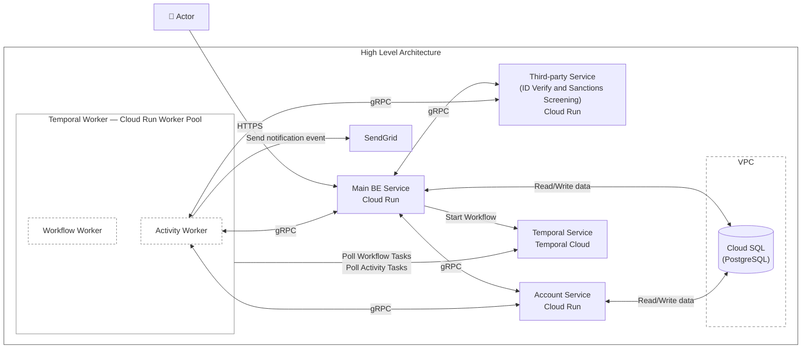

# High Level Architecture

## Component Ownership

| Component | Ownership / Responsibility |
|---|---|
| **Actor** | Initiates onboarding requests and interacts with Main BE over HTTPS. |
| **Main BE Service (Cloud Run)** | Owns the customer-facing application APIs, onboarding application state and application data; reads/writes application data in Cloud SQL; invokes Third-party and Account services over gRPC; starts Temporal workflows. |
| **Third-party Service (Cloud Run)** | Owns ID verification and sanctions screening operations; exposes gRPC operations to callers. |
| **Account Service (Cloud Run)** | Owns bank account creation and account-number generation; reads/writes account data in Cloud SQL; exposes gRPC operations. |
| **Cloud SQL (PostgreSQL)** | Persists application data from Main BE and account data from Account Service. |
| **Temporal Service (Temporal Cloud)** | Owns durable workflow orchestration state and dispatches workflow/activity tasks for workers to poll. |
| **Temporal Worker (Cloud Run Worker Pool)** | Hosts Workflow Worker and Activity Worker; polls Temporal Cloud for workflow and activity tasks. |
| **Workflow Worker** | Executes the workflow orchestration logic. |
| **Activity Worker** | Executes activities that communicate with Main BE, Account Service, and Third-party Service over gRPC and send notification events to SendGrid. |
| **SendGrid** | Receives notification events from the Activity Worker and handles email delivery. |
