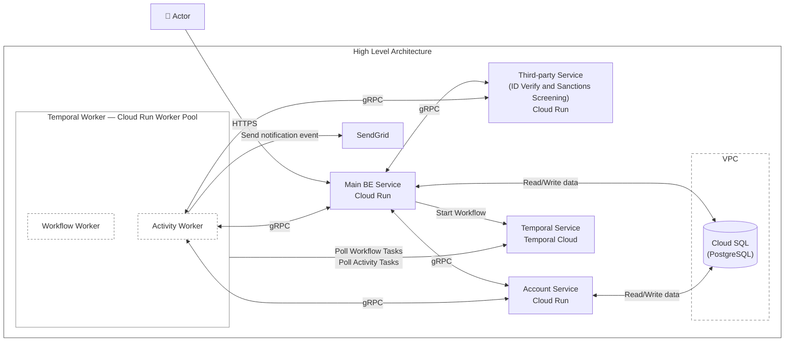

# High Level Architecture

## Application transaction ownership

AcceptTermsService and SubmitIdentityService own their transaction boundaries
through the database-independent `service.Transactor.WithinTx(ctx, fn)` port.
Inside the callback they lock the application, read associated records, invoke
domain decisions, and coordinate the inserts and conditional status updates.
Replay performs no writes. SubmitIdentity starts Temporal only after successful
commit; workflow-start status reconciliation uses a separate service-owned
transaction and preserves concurrently progressed application state.

The PostgreSQL Transactor owns Begin, Commit, and cancellation-independent,
bounded rollback cleanup. Its private callback-context binding lets
ApplicationRepository use the same transaction and pool for the application
aggregate, including identity and terms acceptance. Its implementation is split
across application_repository.go, application_identity_repository.go, and
application_terms_acceptance_repository.go. Each service defines only its
consumed repository methods in SubmitIdentityRepository or AcceptTermsRepository.
Transaction-required operations reject contexts
without that binding. Repositories own SQL, scanning, date conversion, and
sanitized database error mapping; domain rules remain in the domain package.
The callback executes once, with no application-level transaction retry.

## Local PR 07 identity verification

Third-party Service implements VerifyIdentity through ConnectRPC handler → service
→ injected IdentityVerifier provider. Its domain identity and structural validation
are independent of protobuf and Application Service persistence. The default
provider compares seven fixed synthetic government records exactly; mismatches
return `verified=false`, while technical failures return sanitized RPC errors.
The mock has no mutable state, clock, or external I/O. The API performs no database
writes; its server still listens on `:8081`. ScreenSanctions remains unimplemented.
Temporal business activities and result orchestration remain deferred; the worker
still waits durably.

Internal VerifyIdentity calls use gRPC over HTTP/2 through the generated
ConnectRPC handler. The local server enables unencrypted HTTP/2 (h2c) using
Go's standard-library `http.Server.Protocols`; HTTP/1 remains enabled for health
checks. Service and provider remain transport-independent. Deployment TLS
configuration is deferred to the cloud phase.

## Local PR 06 implementation

The cloud diagram below remains the later deployment target. Locally Main BE and
the worker use the existing Compose Temporal dev server. Main BE injects a
consumer-owned WorkflowStarter port implemented by its Temporal client adapter;
the domain remains independent of transport. `internal/application/workflow`
contains that startup adapter, while `internal/workflow` contains worker-executed
deterministic code. Both use task queue `bank-onboarding` by default. Main BE owns
all application database writes; worker workflow code currently only waits durably.

## Component Ownership

| Component | Ownership / Responsibility |
|---|---|
| **Actor** | Initiates onboarding requests and interacts with Main BE over HTTPS. |
| **Main BE Service (Cloud Run)** | Owns the customer-facing application APIs, onboarding application state and application data; reads/writes application data in Cloud SQL; invokes Third-party and Account services over gRPC; starts Temporal workflows. |
| **Third-party Service (Cloud Run)** | Owns ID verification and sanctions screening operations; exposes gRPC operations to callers. |
| **Account Service (Cloud Run)** | Owns bank account creation and account-number generation; reads/writes account data in Cloud SQL; exposes gRPC operations. |
| **Cloud SQL (PostgreSQL)** | Persists application data from Main BE and account data from Account Service. |
| **Temporal Service (Temporal Cloud)** | Owns durable workflow orchestration state and dispatches workflow/activity tasks for workers to poll. |
| **Temporal Worker (Cloud Run Worker Pool)** | Hosts Workflow Worker and Activity Worker; polls Temporal Cloud for workflow and activity tasks. |
| **Workflow Worker** | Executes the workflow orchestration logic. |
| **Activity Worker** | Executes activities that communicate with Main BE, Account Service, and Third-party Service over gRPC and send notification events to SendGrid. |
| **SendGrid** | Receives notification events from the Activity Worker and handles email delivery. |
