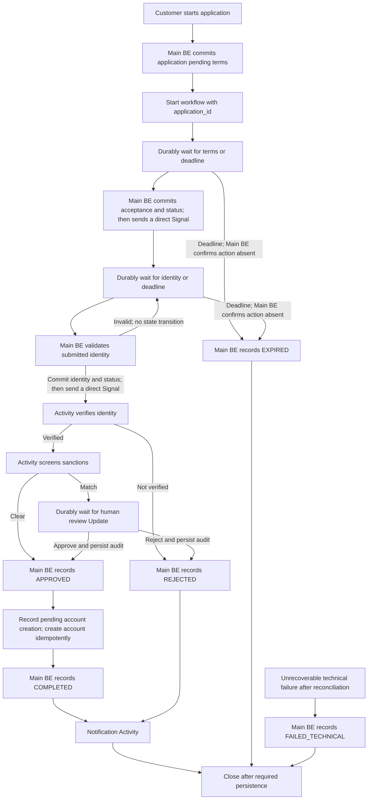
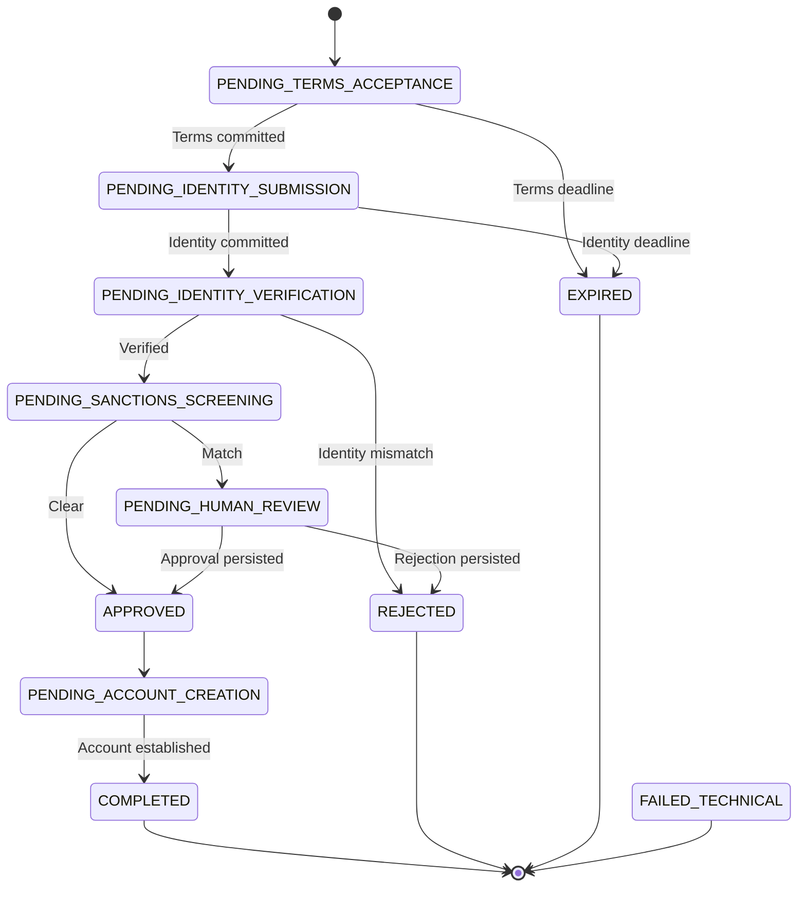

# Onboarding lifecycle

This is the future orchestration target, corrected in PR 09 to direct SDK calls.
PR 09 implements startup only; Signals, Updates, Activities, and timers remain staged. Status labels omit
APPLICATION_STATUS_. EXPIRED requires a future additive contract/schema change.

Invalid customer input leaves the action available for correction. Identity
mismatch and banker rejection are business outcomes. Technical retries happen
before terminal failure. Notification failure never reverses completion/rejection.

FAILED_TECHNICAL is reachable from nonterminal processing after unrecoverable
technical failure and external-effect reconciliation; repeated arrows are omitted.
Terminal states have no normal outgoing transition. An existing account must be
reconciled to completion, not failed because its response was lost.

Terms expire seven days after creation; identity expires seven days after persisted
acceptance. Main BE checks deadlines during action transactions with explicit time
passed to domain rules. New actions at or after the deadline fail; exact replay of
committed actions remains valid. Expiration locks and rechecks persisted actions,
so delayed Signals cannot expire an action committed on time. Human review does
not automatically expire or reject; overdue review requires operational alerts.

PENDING_WORKFLOW_START is retained for legacy compatibility, not used for new
target applications. Startup delivery is separate from business progress.
APPROVED is not COMPLETED; notification delivery is separate from both.
Normal workflow closure follows terminal persistence. Abnormal closure requires
reconciliation rather than inference of a business outcome.

PR 09 starts Temporal after persistence without changing business status. Failed
or uncertain startup requires StartApplication retry with the same request_id.
A crash in this gap has no autonomous recovery. SubmitIdentity commits pending
verification without signaling until PR 11; the current workflow only waits.
