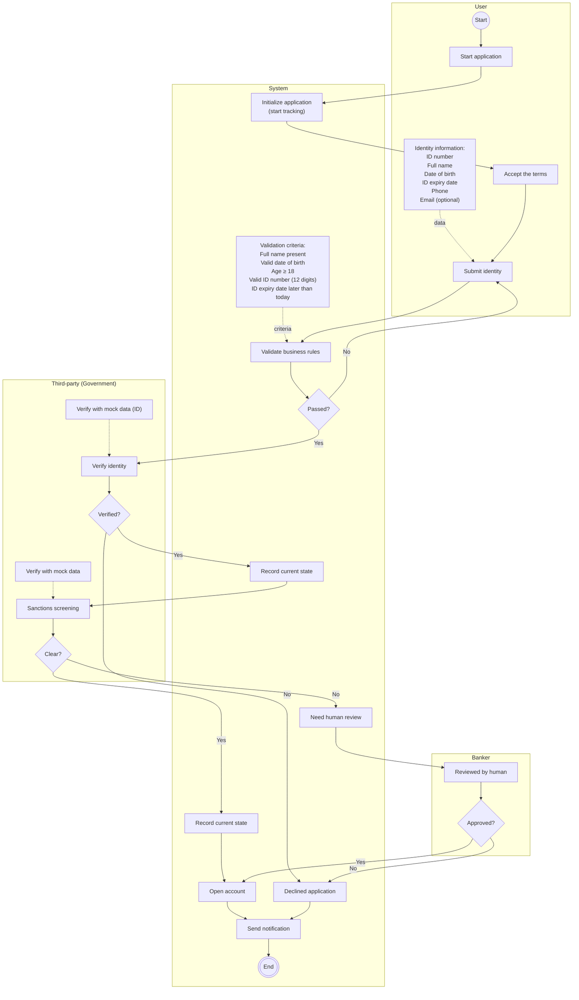

# Business Workflow — Bank Account Onboarding

The Mermaid flowchart below is the business workflow reference for implementation. It preserves the User, System, Third-party (Government), and Banker responsibilities shown in the source diagram.

