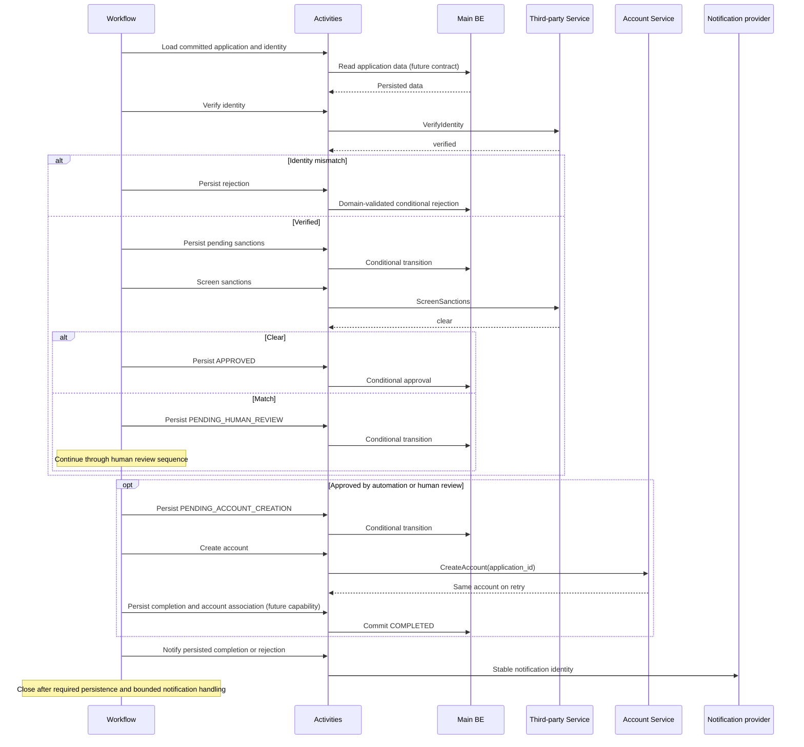

# Onboarding sequences

PR 08 target only. Signal, Update, internal read, and result message names are
design names, not new protobuf declarations. Current workflow code only waits
indefinitely. See architecture.md and retry-policy.md for ownership and recovery.

## Creation and customer actions

```mermaid
sequenceDiagram
    autonumber
    actor Customer
    participant Main as Main BE
    participant DB as PostgreSQL
    participant T as Temporal
    participant W as Workflow
    Customer->>Main: StartApplication(request_id)
    Main->>DB: WithinTx: application pending terms and start intent
    DB-->>Main: Commit
    Main->>T: Ensure started (Workflow ID = application_id)
    T-->>Main: Accepted or existing
    Main-->>Customer: Application ID and persisted status
    T->>W: Execute workflow task
    Note over W: Register handlers; durable wait for terms/deadline
    Customer->>Main: AcceptTerms(application_id, term_id)
    Main->>DB: WithinTx: lock, domain decision, acceptance, status, Signal intent
    DB-->>Main: Commit
    Main->>T: TermsAccepted(stable event ID, committed reference)
    Main-->>Customer: accepted = true
    T->>W: Deliver Signal
    Note over W: Durable wait for identity/deadline
    Customer->>Main: SubmitIdentity(application_id, identity)
    Main->>DB: WithinTx: lock, validate, identity, pending verification, Signal intent
    DB-->>Main: Commit
    Main->>T: IdentitySubmitted(stable event ID, committed reference)
    Main-->>Customer: Application ID and persisted status
    T->>W: Deliver Signal
    Note over W: Process only after both committed actions are established
```

Responses depend on committed business data and intent, not immediate delivery.
Outages leave intents pending. Temporal can accept startup/Signals while workers
are offline. Early/reordered Signals are retained and guarded; duplicates cannot
repeat business transitions. All external calls are outside database transactions.

## Automated processing



Each Main BE write uses a use-case service, domain transition, and service-owned
transaction. Workers never write application tables. Business rejection cannot
fall through into account creation. Technical failures interrupt this happy path.

## Human review Update

```mermaid
sequenceDiagram
    actor Banker
    participant Main as Main BE
    participant T as Temporal
    participant W as Workflow
    participant A as Review persistence Activity
    participant DB as PostgreSQL
    Banker->>Main: ReviewApplication(review_request_id, decision, reason)
    Main->>Main: Authenticate, authorize, validate request
    Main->>T: Update with stable review request ID
    T->>W: Execute Update handler
    W->>W: Check phase; reserve one decision before yielding
    W->>A: Persist accepted review
    A->>Main: Record review with authenticated reviewer context
    Main->>DB: WithinTx: lock, domain decision, audit, request result, status
    DB-->>Main: Commit
    Main-->>A: Durable result
    A-->>W: Persisted
    W-->>T: Update completed with durable decision result
    T-->>Main: Accepted decision and resulting status
    Main-->>Banker: ReviewApplicationResponse
    Note over W: Approval continues account creation; rejection continues notification
```

Only APPROVED/REJECTED are final choices. Competing decisions conflict; exact
request replay returns its durable result. Timeout after acceptance is uncertain:
retry the same ID/payload. Workflow guards arbitrate; Main BE locking/domain rules
and constraints enforce persistence safety. Reviewer propagation/internal audit
contracts remain future work. Required handlers finish before workflow closure.

## Delivery recovery and expiration

```mermaid
sequenceDiagram
    participant Main as Main BE
    participant DB as PostgreSQL
    participant R as Delivery recovery
    participant T as Temporal
    Main->>DB: Commit business data and delivery intent
    Note over Main: Crash before delivery or response lost after acceptance
    R->>DB: Claim pending intent with bounded lease
    DB-->>R: Stable intent and application reference
    R->>T: Establish startup; deliver dependent Signal
    T-->>R: Accepted or reconciled duplicate
    R->>DB: Acknowledge delivery
    Note over R,T: Crash before acknowledgment causes safe duplicate delivery
```

Acknowledgment means Temporal acceptance, not processing. Expiration uses a durable
timer followed by a Main BE transaction: lock, recheck deadline/action, then persist
EXPIRED or return the committed action so orchestration continues. Startup delay
does not reset deadlines. No worker task remains active while waiting.