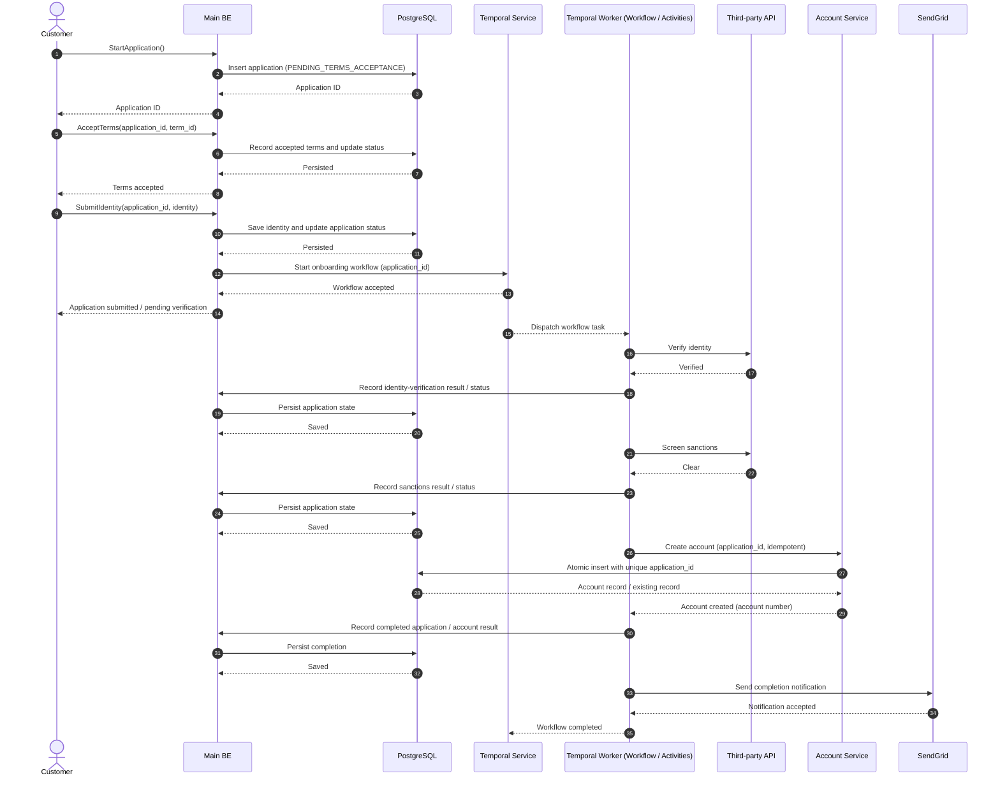
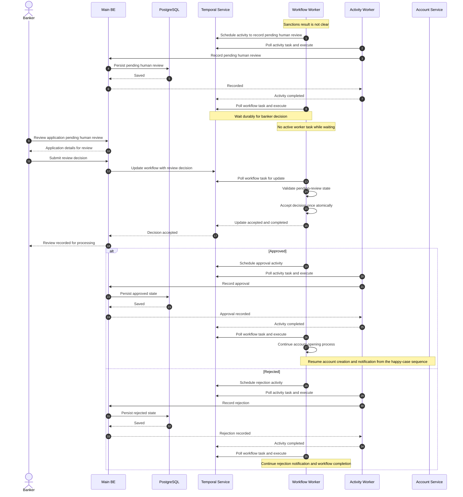

# Account Opening — Happy-Case Sequence

The Mermaid diagram below transcribes the principal interactions visible in the supplied **Full Creating Account Process (Happy Case)** sequence diagram. It focuses on the happy path; failure handling is documented separately in docs/AI/retry-policy.md

PR 06 starts Temporal after PR 05's atomic identity/pending-start commit. Exact
identity retries at pending-start attempt the same workflow ID again; other
progressed states return unchanged. Accepted startup conditionally advances to
`PENDING_IDENTITY_VERIFICATION`. Startup failure never rolls back identity.
The local worker runs only a deterministic durable wait with no activities.
The business activity interactions below remain future behavior. Detailed startup
errors and completed-execution reconciliation are in `retry-policy.md`.

## Sanctions Match Requires Human Review

This diagram transcribes the human-review sequence in the supplied image. Message names are descriptive, not new API contracts. Small labels in the image are not fully legible. The pending-review state is written descriptively below rather than assigning an unconfirmed status enum.

Application-state writes are shown through Main BE to preserve its database ownership. The source image abbreviates these as Activity Worker database writes. Review validation and acceptance must be serialized so concurrent decisions cannot both take effect.
